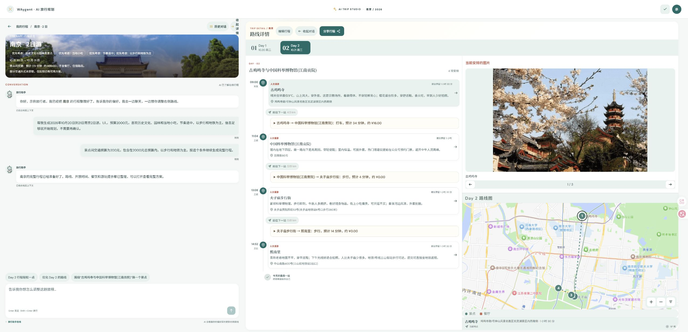
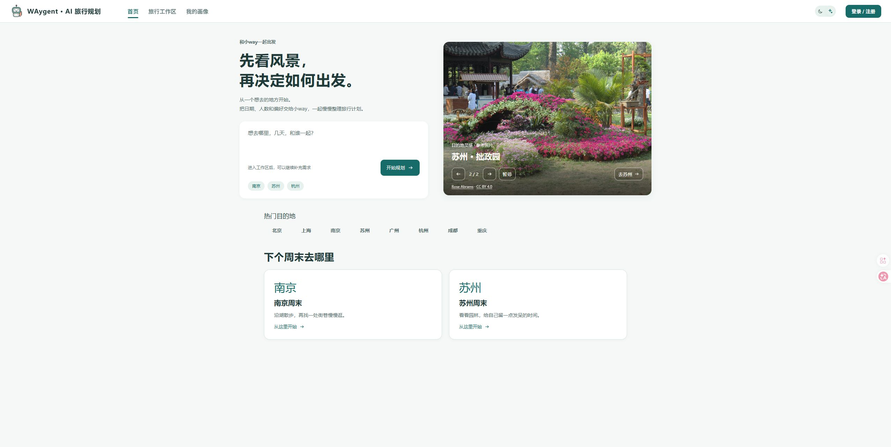
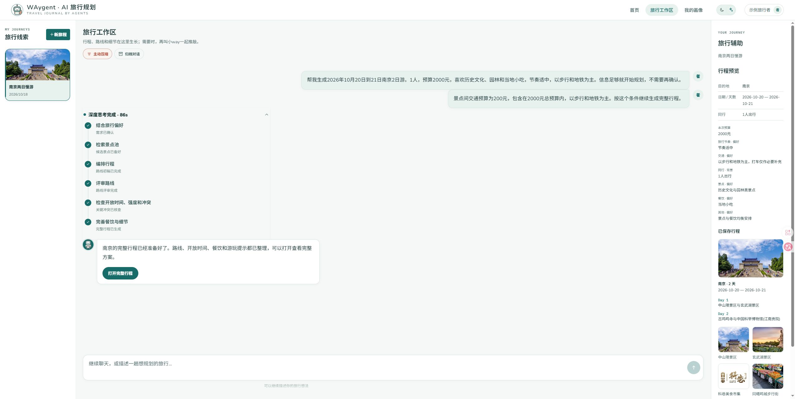
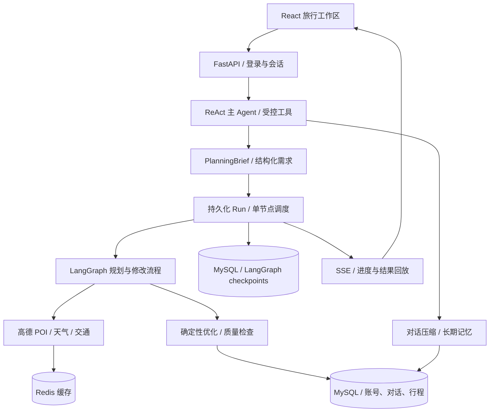

<div align="center">

# WAygent

### 从一句旅行想法，到可以继续推敲的完整行程

聊清目的地与偏好，让 Agent 查资料、排路线、检查时间。<br />
在同一个工作区查看执行进度、浏览地图，并继续调整你的旅行计划。


[](LICENSE)

[功能](#features) · [界面展示](#screenshots) · [快速开始](#quick-start) · [工作原理](#architecture) · [配置](#configuration)

</div>

<p align="center"></p>

<a id="features"></a>
## 能做什么

| 能力 | 使用体验 |
| --- | --- |
| **边聊边补齐旅行需求** | 描述目的地、日期、天数与偏好，主 Agent 通过受控工具整理规划需求，必要时继续询问。 |
| **查真实地点，再安排行程** | 查询高德景点、天气与交通信息，由候选生成、确定性优化和质量检查共同完成规划。 |
| **看得到任务正在做什么** | 展示规划与工具执行进度；任务、事件和结果持久化，支持 SSE 事件回放、取消和重试。 |
| **对照行程与地图浏览** | 在详情工作区切换日期，联动查看当天安排、地点资料、图片与地图位置。 |
| **生成以后继续改** | 通过对话提出调整，也可进入编辑界面修改地点、时间与顺序，保留行程版本关系。 |
| **记住有用的旅行偏好** | 管理旅行画像，压缩较早对话，整理可复用的长期记忆，为后续规划提供上下文。 |

<a id="screenshots"></a>
## 界面展示

### 从一个旅行想法开始

<p align="center"></p>

### 对话与执行进度

<p align="center"></p>

### 行程、地点与地图一起看

<p align="center"></p>

截图来自这个仓库的独立部署，使用示例账号和示例出行需求。页面中的地图、天气和地点信息受服务商数据及 Key 权限影响；规划结果不构成预订，也不保证实时营业、价格或交通情况。

<a id="quick-start"></a>
## 快速开始

需要 Docker Engine / Desktop、Docker Compose，以及你自己的模型和高德 API Key。

### 1. 获取代码

```bash
git clone https://github.com/sagiri942/WAygent.git
cd WAygent
cp .env.example .env
```

Windows PowerShell 最后一行使用 `Copy-Item .env.example .env`。

### 2. 配置服务

编辑 `.env`：

```dotenv
LLM_PROVIDER=deepseek
DEEPSEEK_API_KEY=填写你的模型密钥
AMAP_API_KEY=填写高德Web服务Key
AMAP_JS_KEY=填写高德Web端JS_API_Key
AMAP_JS_SECURITY_CODE=填写JS_Key配套安全密钥
```

模型服务需具备工具调用能力；可通过 `DEEPSEEK_BASE_URL`、`DEEPSEEK_MODEL` 调整服务地址和模型。也支持豆包，配置 `LLM_PROVIDER=doubao`、`DOUBAO_API_KEY` 和 `DOUBAO_MODEL`。是否可用取决于所选模型与服务端能力。

高德 Web 服务 Key 用于后端的地点、天气与交通查询；Web 端 JS API Key 与安全密钥用于浏览器地图。请分别开通对应服务，并为部署域名设置适当的使用限制。首次生成行程和后续对话会调用你配置的模型及地图服务。

正式部署前，修改 `MYSQL_PASSWORD`、`MYSQL_ROOT_PASSWORD`，并设置随机的 `JWT_SECRET`。数据库密码会进入连接 URL，请使用足够长的字母与数字组合。

### 3. 启动

```bash
docker compose --env-file .env -f compose.yaml up -d --build
docker compose --env-file .env -f compose.yaml ps
```

访问 **http://localhost:8765**，注册自己的账号后开始使用。通过 `WAYGENT_HTTP_PORT` 修改访问端口。

Compose 会创建独立的 MySQL、Redis 和应用数据卷。首次启动自动创建业务与 checkpoint 两个 schema、执行迁移并初始化空安装记录，无需导入作者的数据库，也无需预建外部 Docker 网络。应用启动后使用 `/api/ready` 检查存储与 Runtime 是否就绪。

### 4. 查看日志与更新

```bash
docker compose --env-file .env -f compose.yaml logs -f app
git pull
docker compose --env-file .env -f compose.yaml up -d --build
```

重建应用会保留命名卷中的账号、对话和行程。不要通过删除数据卷来执行日常更新。

<a id="architecture"></a>
## 工作原理

主 Agent 使用 ReAct 工具调用，负责理解用户意图、读取上下文、维护规划需求和提交任务。完整行程生成由 LangGraph 规划流程执行：天气与地点检索 → 候选生成 → 确定性优化 → 交通检查 → 质量检查 → 保存结果。模型负责语义理解和候选组织，程序负责可计算的约束与结果校验。



| 位置 | 职责 |
| --- | --- |
| `app/chat/` | 主 Agent、受控工具、需求整理与对话上下文 |
| `app/planning/` | 规划图、候选构建、优化、质量检查和行程修改 |
| `app/runtime/` | Run 状态、调度、事件、交互恢复与 checkpoints |
| `app/providers/` | 地图等外部服务适配 |
| `app/core/` | 认证、业务存储、记忆、缓存和通用能力 |
| `app/api/` | HTTP / SSE 接口 |
| `frontend/` | React 页面、样式、地图交互与本地静态构建产物 |
| `migrations_mysql/` | 业务数据库迁移 |
| `app/bootstrap.py`、`scripts/start.py` | 空环境初始化与容器启动 |

<a id="configuration"></a>
## 配置说明

完整的常用配置见 [`.env.example`](.env.example)。

| 配置 | 用途 |
| --- | --- |
| `WAYGENT_HTTP_PORT` | 对外访问端口，默认 8765 |
| `LLM_PROVIDER`、`DEEPSEEK_*`、`DOUBAO_*` | 模型提供商、密钥、地址与模型 |
| `MAIN_AGENT_MODEL`、`PLANNING_AGENT_MODEL` | 分别覆盖主 Agent 和规划任务的模型 |
| `AMAP_API_KEY` | 后端高德服务 |
| `AMAP_JS_KEY`、`AMAP_JS_SECURITY_CODE` | 前端地图 |
| `JWT_SECRET` | 登录令牌签名；留空时生成并保存本地开发密钥 |
| `RUNTIME_*_CONCURRENCY` | 任务与外部服务调用的并发上限 |
| `RUNTIME_REVISION_TIMEOUT_SECONDS` | 行程修改的总截止时间 |

容器内 `WAYGENT_MYSQL_DSN`、`WAYGENT_CHECKPOINT_DSN` 和 `REDIS_URL` 由 Compose 配置。MySQL 和 Redis 不发布宿主机端口；前端静态资源与 API 由同一个 FastAPI 服务提供。

## 本地开发

前端的编译产物随仓库提供，正常部署不需要运行浏览器端编译器。修改 JSX / JS 后重新构建：

```bash
cd frontend
npm ci
npm run build
npm run check
```

后端建议使用 Python 3.13.2 和 `requirements.runtime.lock.txt` 的固定依赖。checkpoint schema 与 MySQL 8.4.11、saver 3.0.0 的验证规则配套；不要单独替换这些版本。直接在宿主机运行时，需要自行配置两个独立的 MySQL schema、Redis 与环境变量；推荐先使用 Docker 部署验证。

## 发布范围与运行边界

- 仓库保留 Web 应用、提示词、评分配置、必要静态资源、第三方许可和部署文件，不携带真实账号、对话、行程、数据库、密钥、开发文档或测试评测集。
- 当前采用单应用进程和单节点 Runtime；多个副本同时连接同一套状态存储的调度一致性未作保证。
- 部分景点缺少图片或评分时，页面会显示占位或按规划规则处理；地图可用性取决于高德 Key 的权限与部署域名设置。
- 真实业务数据应做好备份；服务商调用失败、限额和网络情况会影响任务完成。

## 许可证

项目代码使用 [MIT](LICENSE)。第三方库与照片保留各自的许可，见 [资源说明](THIRD_PARTY_NOTICES.md)。
